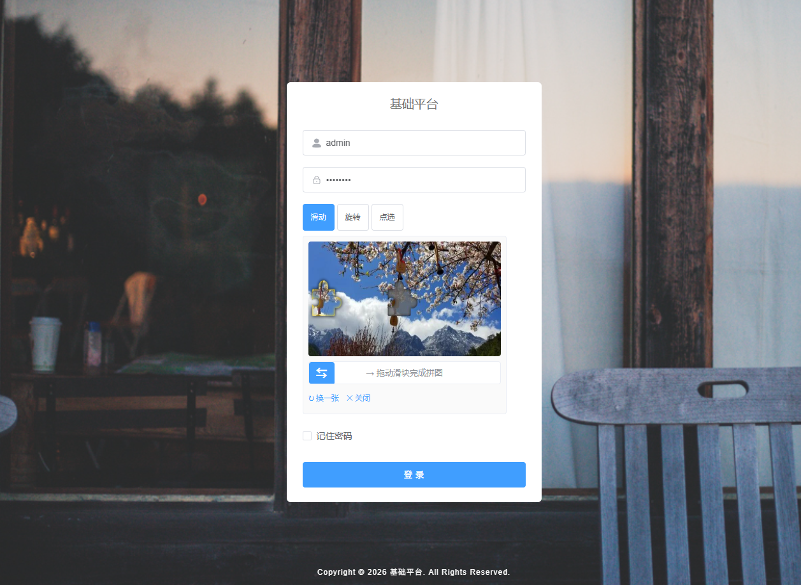
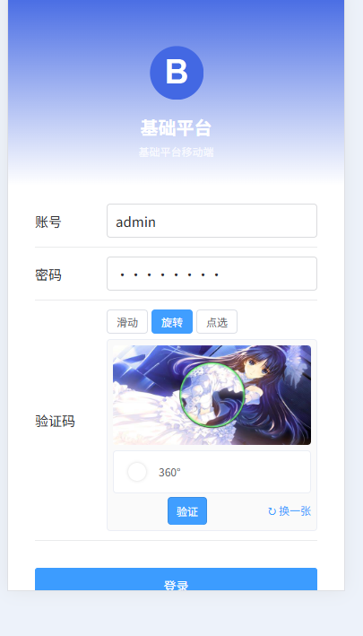

# Basic Admin (Spring Boot 2.5.14 + Vue 3 + Element Plus)

基于若依 RuoYi-Vue 3.8.2 改造,**未做后端版本升级**,只是修复了 sql bug、加了锁屏解锁功能、并集成 tianai-captcha 行为验证码。

> 当前分支:`springboot2-tianai-captcha` ——「**RuoYi-Vue 3.8.2 最小改造 + 行为验证码**」。
> 仓库另有 `master` / `master-extend-flowable` / `springboot2_TypeScript` / `springboot3` / `springboot3_TypeScript` / `springboot4` / `springboot4_TypeScript` 等分支做不同技术栈组合,本分支**只描述本分支**。

---

## 前端说明

本仓库前端有 **两个**独立子项目,都是 **JavaScript 版**(无 TypeScript):

### 1.1 PC 管理端 `web-ui/`

- 框架:Vue 3.5.26 + Element Plus 2.13.1
- 构建:Vite 6.4.1
- 代码:纯 `.js` / `.vue`,**无 `typescript` 依赖**(package.json 不含 `typescript`)

> TS 版在 `springboot2_TypeScript` / `springboot3_TypeScript` / `springboot4_TypeScript` 分支,本分支**未涉及**。

### 1.2 移动端 `web-mp/`(本分支新增)

- 框架:**uni-app 3.0 (alpha)** + Vue 3.4.21(组合式 API `<script setup>`)
- UI:**uview-plus 3.3.62**(uView 的 Vue3 版本,组件名带 `up-` 前缀)
- 构建:Vite 5.2.x
- 一份代码同时跑 **H5 / 微信小程序 / Android / iOS / 其它小程序**
- 状态管理:Pinia 2.0.36
- 加密:jsencrypt(对接后端 RSA 登录)
- **不走 HBuilderX**,全部走 CLI:`pnpm dev:h5` / `pnpm dev:mp-weixin` / `pnpm dev:app`

> 详细说明见下文**「七、移动端 `web-mp`」** 章节。

---

## 一、当前后端状态(基于 `git show HEAD:pom.xml`)

> 本分支**后端没升级**。基于若依 RuoYi-Vue 3.8.2 原始 SB 2.x 配置。

| 组件 | 版本 |
|---|---|
| **JDK** | **11** |
| Spring Boot | **2.5.14** |
| Spring Framework | 5.3.x |
| Spring Security | 5.5.x |
| MyBatis-Plus | 3.5.1 |
| Druid | 1.2.8(`druid-spring-boot-starter`,无 `-3-` 写法) |
| PageHelper | 1.4.1 |
| swagger | springfox 3.0.0 |
| Hutool | hutool-bom 5.8.3(bom 模式) |
| bitwalker | 1.21(用户代理字符串解析) |
| kaptcha | 2.3.2 |
| poi | 4.1.2 |
| commons-io | 2.11.0 |
| oshi | 6.1.6 |
| jakarta.servlet | (用 javax.servlet) |

---

## 二、本分支是什么

本分支 `springboot2-tianai-captcha` 基于 **若依 RuoYi-Vue 3.8.2** 原始仓库改造而来,**后端保持 Spring Boot 2.5.14 / JDK 11 / Spring Security 5.5 不升级**,在 `master` 基线上额外叠加了:

1. **SQL bug 修复 + 锁屏解锁功能**(后端 `SysLoginController` / `SysLoginService` / `SysRole` / 若干 Mapper 微调)
2. **数据库脚本切换到 PostgreSQL**:`file-sql/basicdb-vue3.sql`(34 张表 + 5 函数,`basicdb` schema,`COPY ... FROM stdin` 流式导入)
3. **新增移动端前端 `web-mp/`**:uni-app 3 + uview-plus 3,支持 H5 / 微信小程序 / App,对接本仓库后端的 `/login` `/getInfo` `/getRouters` 等接口
4. **行为验证码**:把原 kaptcha 字符验证码整体替换为 tianai-captcha 行为验证码,PC 端与移动端均支持 **滑动 / 旋转 / 文字点选** 三种类型切换(详见第九章)
5. **README 与脚本多次重导出的整理**

`master` 是「**最小可用 + 后端零升级**」的稳定基线,本分支在其之上只增加了行为验证码;其他分支(`master-extend-flowable` / `springboot3` / `springboot4` 等)都基于或并行于 `master` 做技术栈升级。

---

## 三、相对 RuoYi 原版的具体改动

| 改动 | 涉及文件 / 位置 |
|---|---|
| 锁屏解锁接口 | `SysLoginController.java`、`SysLoginService.java` |
| 角色表 / 用户 / 部门 / 菜单 Mapper | `SysRoleMapper.xml`、`SysUserMapper.xml`、`SysDeptMapper.java/xml`、`SysMenuMapper.java` |
| `SysRole` 实体微调 | `SysRole.java` |
| 数据库脚本 | `file-sql/basicdb-vue3.sql`(由 RuoYi 原始 MySQL 脚本迁成 PostgreSQL,统一放在 `basicdb` schema) |
| 移动端项目 | 新增 `web-mp/`(uni-app 3 + uview-plus 3,**不**在 maven module 列表里) |
| 行为验证码(后端) | `TianaiCaptchaConfig.java`、`TypeAwareImageCaptchaValidator.java`、`CaptchaController.java`、`CaptchaCheckController.java`、`SysLoginService.java`、`LoginBody.java`、`SecurityConfig.java`、`basic-framework/pom.xml`;删除 `CaptchaConfig.java`、`KaptchaTextCreator.java` |
| 行为验证码(前端) | 新增 `web-ui/src/components/TianaiCaptcha/`、`web-mp/src/components/tianai-captcha/`;改造两端登录页与 `api/login.js` |
| 验证码背景图 | `basic-framework/src/main/resources/META-INF/cut-image/`(模板 + 背景图,丢图即生效) |

---

## 四、运行前 checklist

- [x] JDK 11 安装
- [x] Node.js + pnpm(前端)
- [x] `cd web-ui && pnpm install` 拉依赖(PC 端)
- [x] `cd web-mp && pnpm install` 拉依赖(移动端,本分支新增)
- [ ] `pnpm dev` 验证 PC 端启动(`web-ui`)
- [ ] `pnpm dev:h5` 验证移动端 H5 启动(`web-mp`)
- [x] 7 个子模块 `parent.version` 一致为 `3.8.2`
- [x] IDE 工程的 Project SDK 设为 JDK 11,Language level 11
- [x] `mvn clean compile` 0 ERROR
- [ ] 应用启动成功,日志出现 `[tianai-captcha] ... loaded`
- [ ] admin 登录成功(PC / 移动端)
- [ ] 锁屏功能可用(RuoYi 原版无此功能)
- [ ] 三种验证码(滑动 / 旋转 / 点选)均可切换并通过校验

---

## 五、其他分支(参考)

本仓库其他分支(切到对应分支看其 README):

| 分支 | 做什么 |
|---|---|
| `master-extend-flowable` | master + **Flowable 6.8.0 流程引擎**集成(新增 `extend-flowable` 子模块),数据库从 MySQL 迁到 PostgreSQL(schema `basicdb_flowable`,86 张表 + 2 视图);并增加流程建模/部署/发起/审批/退回/转办/委派/加签/抄送等业务 |
| `springboot2_TypeScript` | 同 master 后端,前端 JS → TS 化 |
| `springboot3` | 后端 SB 2.5.14 → 3.5.16(JDK 11 → 17),Jakarta EE + Spring Security 6 + springdoc + ... |
| `springboot3_TypeScript` | `springboot3` + 前端 TS 化 |
| `springboot4` | 后端 SB 3.5.16 → 4.1.1(JDK 17 → 21),Jackson 3 + Spring Security 7 + Spring Framework 7 + ... |
| `springboot4_TypeScript` | `springboot4` + 前端 TS 化(最完整栈) |

> `master-extend-flowable` 是从 master 的某个早期 commit 分叉而来,**包含 web-mp**;
> 其 HEAD 在 master 基础上多了一个 `feat(workflow): 集成 Flowable 流程引擎并切换到 PostgreSQL`
> 的大变更(346 文件 / +58906 / -3072)。

---

## 六、数据库脚本 (`file-sql/basicdb-vue3.sql`)

> 本分支运行所需的 **PostgreSQL 全库结构 + 初始化数据** 都打在一个脚本里,统一用
> `file-sql/basicdb-vue3.sql`(原名 `dump-basicdb-vue3-202609301413.sql`,已重命名去掉时间戳)。
> 其它 `file-sql/*.sql` 是历史中间产物,本分支**不直接使用**;真正要执行的就是这一个。

### 6.1 脚本基本信息

| 项 | 值 |
|---|---|
| 文件路径 | `file-sql/basicdb-vue3.sql` |
| 文件大小 | 约 1.55 MB / 9655 行 |
| 来源 | `pg_dump` 导出(导出自 PostgreSQL 15.1,导出工具 pg_dump 17.0) |
| 导出时间 | 2026-09-30 14:13:00 |
| 数据库角色 | 所有对象 `OWNER TO system`(导入前**必须**先有 `system` 角色) |
| Schema | `basicdb`(脚本里所有表/函数/序列都在该 schema 下) |
| 表数量 | **34 张**(`gen_*` 2 + `qrtz_*` 11 + `sys_*` 21) |
| 函数数量 | 5 个(`date_format` / `exec` / `find_in_set` / `ifnull` / `tabledef`) |
| 数据加载方式 | `COPY ... FROM stdin;`(原生 psql `\copy` 流式导入,**不**走 `INSERT`) |
| PostgreSQL 要求 | **>= 15.1**(用到了 `to_char` / `format` / `pg_get_partkeydef` 等 14+ 才稳定的写法) |

### 6.2 表清单(共 34 张,均位于 `basicdb` schema)

#### 代码生成(`gen_*`,2 张)

| 表 | 用途 |
|---|---|
| `gen_table` | 代码生成业务表配置 |
| `gen_table_column` | 代码生成字段配置 |

#### 定时任务(`qrtz_*`,11 张)

`qrtz_blob_triggers` / `qrtz_calendars` / `qrtz_cron_triggers` / `qrtz_fired_triggers` /
`qrtz_job_details` / `qrtz_locks` / `qrtz_paused_trigger_grps` / `qrtz_scheduler_state` /
`qrtz_simple_triggers` / `qrtz_simprop_triggers` / `qrtz_triggers`

#### 业务系统(`sys_*`,21 张)

| 表 | 用途 |
|---|---|
| `sys_config` | 全局参数 |
| `sys_demo` | 演示样例 |
| `sys_dept` | 部门 |
| `sys_dict_data` | 字典值 |
| `sys_dict_type` | 字典类型 |
| `sys_files` | 文件 |
| `sys_i18n` | 国际化文案 |
| `sys_job` | 定时任务 |
| `sys_job_log` | 定时任务日志 |
| `sys_logininfor` | 登录日志 |
| `sys_menu` | 菜单(含 `is_resource` / `show_tags` / `menu_name_en` / `menu_name_zh_hant` 等扩展列) |
| `sys_notice` | 通知公告 |
| `sys_oper_log` | 操作日志 |
| `sys_post` | 岗位 |
| `sys_role` | 角色 |
| `sys_role_dept` | 角色-部门关联 |
| `sys_role_menu` | 角色-菜单关联 |
| `sys_sms_message` | 短信发送记录 |
| `sys_user` | 用户 |
| `sys_user_post` | 用户-岗位关联 |
| `sys_user_role` | 用户-角色关联 |

### 6.3 恢复步骤(全新数据库)

> 以下命令假设 PostgreSQL 监听 `localhost:5432`,超级用户 `postgres`,密码在环境变量
> `PGPASSWORD` 里。**整套流程只会创建 `system` 角色 + `basicdb` schema + 表/函数/数据**,
> 不会触碰 `postgres` 自带的对象。

```bash
# 1) 建 system 角色和 basicdb 库(SQL 脚本本身不建角色,必须先建好)
psql -U postgres -h localhost -c "CREATE ROLE system LOGIN PASSWORD 'system';"
psql -U postgres -h localhost -c "CREATE DATABASE basicdb OWNER system;"

# 2) 导入 schema + 数据(约 1~2 秒)
psql -U system -h localhost -d basicdb -f file-sql/basicdb-vue3.sql

# 3) 验证(应返回 34)
psql -U system -h localhost -d basicdb -c \
  "SELECT count(*) FROM information_schema.tables WHERE table_schema='basicdb';"
```

如果本地 PostgreSQL 实例没有 `system` 角色,直接执行第 2 步会报
`ERROR: role "system" does not exist`,补一步 1) 即可。

### 6.4 备份该数据库的命令(导出成同款脚本)

```bash
pg_dump -U system -h localhost -d basicdb \
  --schema=basicdb --no-owner --no-privileges \
  --file=file-sql/basicdb-vue3.sql
```

- 加 `--no-owner --no-privileges` 后,导出的脚本**不再**带 `OWNER TO system`、
  不再写死角色,可移植到任意环境(但要保证导入账号对 `basicdb` schema 有 ALL 权限)。
- 不加这两个开关,导出结果与本仓库现存的 `basicdb-vue3.sql` 格式一致(对象 `OWNER TO system`)。
- 脚本里所有 `data` 段都用了 `COPY ... FROM stdin;`,导入端必须用 `psql`
  (不要用某些 GUI 工具的「执行 SQL」入口,会把 `COPY` 当成语法错误)。

### 6.5 默认账号

| 用户名 | 密码(明文) | 备注 |
|---|---|---|
| `admin` | `admin123` | 超级管理员,登录后请立刻改密 |

(`admin` 账号的密文在 `sys_user.password`,默认与 RuoYi-Vue 3.8.2 原始脚本一致;
要重置可执行同目录的 `reset-admin-password.sql`。)

### 6.6 与应用连接配置(`application.yml` / `application-druid.yml`)

后端连接 `basicdb` 的关键配置:

```yaml
spring:
  datasource:
    type: com.alibaba.druid.pool.DruidDataSource
    driver-class-name: org.postgresql.Driver
    url: jdbc:postgresql://localhost:5432/basicdb?currentSchema=basicdb
    username: system
    password: system
```

> `currentSchema=basicdb` 必须加,否则 MyBatis 找不到 `sys_user` / `sys_menu` 等表
> (脚本里所有表都建在 `basicdb` schema 下,不是 `public`)。

### 6.7 其它 `file-sql/*.sql` 说明(本分支**不直接使用**,留作历史)

| 文件 | 角色 |
|---|---|
| `basic-sql-2023-03-02.sql` | 早期 MySQL 5.7 全库脚本,**非 PostgreSQL**,本分支不要混用 |
| `quartz.sql` | 单独的 Quartz 建表脚本,**已被 `basicdb-vue3.sql` 内置的 11 张 `qrtz_*` 表覆盖** |
| `ry_20210908.sql` | RuoYi 3.8.2 原始 MySQL 全库脚本,**非 PostgreSQL**,对照用 |
| `reset-admin-password.sql` | 把 `admin` 密码重置回 `admin123` 的小工具,按需手动跑 |
| `reset-all-passwords.sql` | 把**所有**用户密码统一重置回默认的小工具,慎用 |
| `fix-sys-menu-component.sql` | 修 `sys_menu.component` 路径里 `system` 写错的,按需手动跑 |
| `create-sys-notice-read.sql` | 补建 `sys_notice_read`(用户已读记录)表,按需手动跑 |

> 一句话:**运行本项目,只跑 `basicdb-vue3.sql` 这一个文件就够了**。
> (注:`master-extend-flowable` 分支已经把上述 7 个历史脚本里的部分文件删掉了,
> 因为该分支的 `basicdb-vue3.sql` 已经覆盖了 Quartz 等内容;master 分支目前**仍保留**。)

---

## 七、移动端 `web-mp/`

> 本节是 `web-mp/README.md` 的摘要,
> 完整内容以子目录的 README 为准。

### 7.1 技术栈

| 项 | 版本 |
|---|---|
| uni-app | 3.0 (alpha,`@dcloudio/uni-app@3.0.0-4060620250520001`) |
| Vue | 3.4.21(**组合式 API** `<script setup>`) |
| Vite | 5.2.8 |
| UI | **uview-plus** 3.3.62(uView 的 Vue3 版本,组件名带 `up-` 前缀) |
| 状态管理 | Pinia 2.0.36 |
| 加密 | jsencrypt(对接后端 RSA 登录) |
| 时间 | dayjs 1.11.x |
| 国际化 | vue-i18n 9.13.1(已引入,词条待补) |
| 语言 | **JavaScript**(无 TypeScript) |
| 包管理 | pnpm |

### 7.2 与 web-ui / 后端的关系

- 与 `web-ui/`(PC 端)**同级目录**,**不**是 web-ui 的子项目,各自独立维护
- 不参与 maven 编译(`pom.xml` 的 module 列表里没有 `web-mp`)
- 对接后端:**直接打**本仓库的 `basic-admin-api`(Spring Boot 2.5 + Spring Security),
  接口复用 `/login` / `/logout` / `/captchaImage` / `/getInfo` / `/getRouters` 等
- 默认账号:`admin / admin123`

### 7.3 目录结构

```
web-mp/
├── index.html                 # H5 入口(vite 用)
├── vite.config.js             # Vite 配置
├── package.json
├── config.js                  # 全局配置(双份,同步到 src/)
├── manifest.json              # 应用清单(双份,同步到 src/)
├── pages.json                 # 页面注册(双份,同步到 src/)
├── sync-config.cjs            # 双份同步脚本
├── scripts/
│   └── fixup-mp-components.cjs  # 微信小程序组件 fixup 脚本
└── src/
    ├── main.js                # 入口:createSSRApp + Pinia + 显式注册 up- 组件
    ├── App.vue                # 根组件(@import uview-plus 全局样式)
    ├── uni.scss               # 全局 SCSS 变量入口
    ├── pages/                 # 业务页面
    │   ├── login/index.vue
    │   ├── index/index.vue    # 首页(TabBar)
    │   ├── workbench/index.vue
    │   ├── user/index.vue
    │   └── common/{notice,profile}/...
    ├── api/                   # 接口层(login / system.* ...)
    ├── store/                 # Pinia(user / permission / app)
    ├── utils/                 # config / auth / request / dict / jsencrypt
    ├── directive/permission.js  # v-hasPermi / v-hasRole
    ├── permission.js          # 全局导航守卫
    └── static/                # 静态资源(TabBar 图标等)
```

### 7.4 关键设计

- **登录流程**:`/captchaImage` → `/login`(RSA 公钥加密密码)→ `/getInfo` → `/getRouters`
- **Token 存储**:`uni.getStorageSync('Basic-Token')`
- **请求封装**:`utils/request.js` 实现拦截器(401 跳登录)
- **权限指令**:`v-hasPermi`(uniapp 3 编译时不支持自定义指令,用 `v-if="hasPermi([...])"` 替代)
- **双份 manifest/pages**:CLI build 找 `src/manifest.json`,dev 找根 `manifest.json`,
  所以两边各放一份,`sync-config.cjs` 同步
- **环境配置**:`src/config.js` 维护 `baseUrl`(默认 `http://localhost:8080`,
  H5 通过 `vite.config.js` 代理到 `/dev-api` → 8080;小程序/真机需改成局域网 IP)

### 7.5 运行

```bash
cd web-mp
pnpm install

# 开发
pnpm dev:h5            # 浏览器访问 http://localhost:8081
pnpm dev:mp-weixin     # 用微信开发者工具打开 dist/dev/mp-weixin
pnpm dev:app           # 编译到 unpackage/dist/dev/app

# 生产构建
pnpm build:h5          # 产物在 dist/build/h5
pnpm build:mp-weixin   # 产物在 dist/build/mp-weixin
pnpm build:app
```

### 7.6 待办(摘自子 README)

- [ ] 接入动态菜单(`/getRouters` → pages.json)
- [ ] 国际化(`vue-i18n` 已引入,词条待补)
- [ ] 消息推送 / WebSocket
- [ ] 修改密码页 + 个人中心编辑
- [ ] 锁屏(手势/PIN)
- [ ] TabBar 图标(`src/static/tabbar/` 需放 6 张 81x81 png)

---

## 八、目录速查

```
base-postgresql-vue3/
├── pom.xml                              # 父 pom(7 个后端子模块,无 web-mp)
├── README.md                            # 本文档
├── ry.sh / ry.bat                       # RuoYi 启动脚本(原版遗留)
├── basic-admin-api/                     # Spring Boot 启动模块
├── basic-admin-core/                    # 业务核心(system 模块)
├── basic-framework/                     # 框架配置
├── basic-common/                        # 通用工具/基类
├── business-core/                       # 业务扩展点
├── extend-quartz/                       # Quartz 定时任务扩展
├── extend-generator/                    # 代码生成扩展
├── extend-flowable/                     # (仅 master-extend-flowable 分支)
├── file-sql/                            # SQL 脚本
├── file-bin/                            # 二进制资源(jar 内置)
├── file-doc/                            # 文档资源(jar 内置)
├── web-ui/                              # PC 端前端(Vue3 + Element Plus)
└── web-mp/                              # 移动端前端(uni-app3 + uview-plus)★ 本分支新增
```

---

## 九、行为验证码(tianai-captcha 1.5.0)集成说明 ★ 本分支新增

> **目标**:把原来的 kaptcha 字符验证码全替换为 tianai-captcha 行为验证码,支持 3 种类型可切换。
> 后端用 `tianai-captcha-springboot-starter:1.5.0`(适配 Spring Boot 2.5.14 + `javax.servlet`);
> 前端**不用官方 web-sdk**,三种交互全部自己实现。

### 9.1 3 种行为验证码

| 类型 | 常量 | 用户操作 | 适用场景 |
|------|------|----------|----------|
| 滑动 | `SLIDER` | 拖动滑块到图片缺口位置 | 登录、注册(最常用) |
| 旋转 | `ROTATE` | 拖动图片/滑块旋转到与缺口重合 | 支付、敏感操作 |
| 文字点选 | `WORD_IMAGE_CLICK` | 按顺序点击图中指定汉字 | 防机器人 |

> **滑动还原 `CONCAT` 已下线**: 前端渲染效果不理想, 传入该类型会自动回退为 `SLIDER`。

#### 效果预览

**PC 端 `web-ui`** — 登录框内三种类型可自由切换,图示为「滑动」:



**移动端 `web-mp`** — H5 / 微信小程序 / App 通用,图示为「旋转」:



### 9.2 后端变更

| 文件 | 改动 |
|------|------|
| `basic-framework/pom.xml` | 加 `cloud.tianai.captcha:tianai-captcha-springboot-starter:1.5.0`(2.5.14 + javax.servlet 兼容版) |
| `basic-framework/.../config/CaptchaConfig.java` | **删除**(原 kaptcha Bean 配置) |
| `basic-framework/.../config/KaptchaTextCreator.java` | **删除** |
| `basic-framework/.../config/TianaiCaptchaConfig.java` | **新增**,见 9.5 资源初始化 |
| `basic-framework/.../config/TypeAwareImageCaptchaValidator.java` | **新增**,按类型区分容差(旋转容差 0.02 太苛刻) |
| `basic-framework/.../config/SecurityConfig.java` | 放行 `/captchaImage`、`/captcha/**` |
| `basic-admin-api/.../controller/common/CaptchaController.java` | **重写**:`GET /captchaImage?type=...` 生成验证码,并把 `viewData` 扁平化下发给前端 |
| `basic-admin-api/.../controller/common/CaptchaCheckController.java` | **新增**:`POST /captcha/check` 即时校验,成功后写 Redis「已验证」凭证 |
| `basic-admin-api/.../controller/system/SysLoginController.java` | `login()` 改 5 参,多传 `captchaData` |
| `basic-framework/.../web/service/SysLoginService.java` | 新增 `validateTianaiCaptcha()`:先查 Redis 凭证,未命中才走 `matching()` |
| `basic-common/.../core/domain/model/LoginBody.java` | 新增 `captchaData` 字段(轨迹 JSON 字符串) |

### 9.3 前端变更

| 文件 | 改动 |
|------|------|
| `web-ui/src/components/TianaiCaptcha/index.vue` | **新增**:PC 端 3 种验证码组件(纯 JS,无 TS),交互全部自实现 |
| `web-ui/src/views/login.vue` | 验证码区域换成 `<TianaiCaptcha>`,登录时携带 `captchaData` |
| `web-ui/src/api/login.js` | `getCodeImg(type)` 加 type 参数;新增 `checkCaptcha({id, data})` |
| `web-ui/src/store/modules/user.js` | login 透传 `captchaData` |
| `web-mp/src/components/tianai-captcha/tianai-captcha.vue` | **新增**:uni-app 跨端版(H5 / 小程序 / App) |
| `web-mp/src/pages/login/index.vue` | 验证码区域换成 `<tianai-captcha>` |
| `web-mp/src/api/login.js` | `getCaptcha(type)` 加 type 参数;新增 `checkCaptcha()` |

> 前端**不依赖** tianai 官方 `tianai-captcha-web-sdk`,全部自己实现,便于深度定制样式与交互。

### 9.4 一次校验的两段式设计

tianai 的 `matching(id, track)` **校验成功后会删除验证码缓存**(防重放),所以不能"前端校验一次 + 登录再校验一次"。本项目的做法:

```
前端点「验证」 ──POST /captcha/check──> matching() 通过
                                        └─ 写入 Redis: captcha:verified:{id} = 1 (TTL 120s)
                                        └─ 返回 200

前端点「登录」 ──POST /login──────────> 先查 captcha:verified:{id}
                                         ├─ 命中 → 删除该 key(一次性) → 放行
                                         └─ 未命中 → 走 matching() 兜底
```

好处:

- 用户拖完立刻知道对错,不必等到登录才报错
- 凭证一次性 + 120 秒过期,不会被重复使用
- Redis 不可用时自动降级为登录时 `matching()`

### 9.5 资源初始化(TianaiCaptchaConfig)

官方 starter 默认 `captcha.init-default-resource=false`,**开箱即用会直接报「store 中模板为空」**。所以这里手动加载三类资源:

| 资源 | 位置 | 说明 |
|------|------|------|
| SLIDER / ROTATE 模板 | `classpath:META-INF/cut-image/template/` | 从 tianai 官方仓库复制,含 `slider_1`、`slider_2`、`rotate_1` |
| 背景图 | `classpath:META-INF/cut-image/resource/` | **自动扫描该目录**,放几张就随机出几张 |
| 点选字体 | JDK 自带中文字体 | `WORD_IMAGE_CLICK` 必须注入字体,否则抛「请设置字体包」 |

#### 想加背景图怎么办

把图片直接丢进:

```
basic-framework/src/main/resources/META-INF/cut-image/resource/
```

- 启动时 `applicationContext.getResources(".../resource/*")` 自动全量注册
- **不用改任何代码**
- 建议 **600×300**(与 tianai 默认宽高比 2:1 一致)、JPG、50~300KB
- 当前已内置 `1.jpg`(官方示例) + `pic1~pic5.jpg`

> 注意 `Resource` 的 `data` 要填**纯 classpath 相对路径**(`META-INF/cut-image/resource/x.jpg`),不能带 `classpath:` 前缀 —— `ClassPathResourceProvider` 内部是直接 `getResourceAsStream(data)` 的。

### 9.6 接口契约

#### GET /captchaImage?type=SLIDER|ROTATE|WORD_IMAGE_CLICK

```json
{
  "code": 200,
  "captchaOnOff": true,
  "uuid": "SLIDER_xxxx",          // 登录时回传
  "img": "data:image/jpeg;base64,...",  // 兼容旧字段 = backgroundImage
  "type": "SLIDER",
  "data": {
    "id": "SLIDER_xxxx",
    "type": "SLIDER",
    "backgroundImage": "data:image/jpeg;base64,...",
    "templateImage": "data:image/png;base64,...",
    "backgroundImageWidth": 600,
    "backgroundImageHeight": 300,
    "templateImageWidth": 110,
    "templateImageHeight": 300
  }
}
```

- `type` 只接受 3 种,其它值(含已下线的 `CONCAT`)**自动回退为 `SLIDER`**
- `data` 里还会扁平化 tianai 的 `CustomData.viewData`(如 `randomY`)
- **`expand`(点选正确答案坐标)绝不会下发**,否则等于把答案给前端

#### POST /captcha/check

```json
{
  "id": "SLIDER_xxxx",
  "data": {
    "bgImageWidth": 600,
    "bgImageHeight": 300,
    "startTime": 1792661829872,
    "stopTime": 1792661832073,
    "left": 448,
    "top": 0,
    "trackList": [ { "t": 0, "x": 0, "y": 0, "type": "drag" } ]
  }
}
```

成功返回 `{"code":200,"msg":"校验通过"}`,失败返回具体原因(如 `basic check fail`)。

#### POST /login

请求体新增 `captchaData` 字段(轨迹对象的 **JSON 字符串**),其余不变。

### 9.7 踩过的坑(改动时务必注意)

#### 轨迹反机器人检测(tianai `BasicCaptchaTrackValidator`)

滑动/旋转提交的 `trackList` 会过 7 项检测,任一不过就返回 `basic check fail`:

| # | 检测 | 要求 |
|---|------|------|
| 1 | 滑动时长 | `stopTime - startTime > 300ms` |
| 2 | 轨迹条数 | `10 <= size <= bgImageWidth * 5` |
| 3 | **首条轨迹** | `\|x\| <= 10 且 \|y\| <= 10` |
| 4 | y 不能全同 | 全相同的 y 视为机器 |
| 5 | 相邻跳跃 | `\|Δx\| <= 50`、`\|Δy\| <= 50` |
| 6 | 速度衰减 | 后 30% 平均间隔 > 前 70% 平均间隔(人手越接近目标越慢) |
| 7 | 越界次数 | `x >= bgImageWidth` 的次数不超过 200 |

对应实现要点:

- **拖动开始立即补一条 `{t:0,x:0,y:0,type:'drag'}`** —— 采样定时器首拍时用户已拖出几十像素,不补必然触发检测 3
- y 加 `sin(t/80)*1.5 + random*1.2` 的微抖动,避开检测 4
- 松手后停留 150ms 再提交,让末段速度自然降低,满足检测 6

#### 旋转角度换算

后端 `StandardRotateImageCaptchaGenerator`:

```java
double degree = 360 - randomX / (bgWidth / 360);   // 抠图块被旋转 degree 度
```

用户把图转正时施加的角度 `rotateDeg ≡ -degree`,所以:

```
rotateDeg = 360 * randomX / bgWidth     =>     left = rotateDeg * bgWidth / 360
```

**写成 `(360 - rotateDeg)` 就反了**,会导致怎么对齐都失败。

另外旋转容差默认 `0.02`(仅 ±7.2°),滑块根本调不准,所以 `TypeAwareImageCaptchaValidator` 把 `ROTATE` 放宽到 `0.10`(±36°),其余类型保持 `0.02`。

#### 坐标一律用百分比

`scaleRatio`(原始坐标 / 容器像素)在首帧必然是 1,次帧才更新,任何"用 `scaleRatio` 折算像素"的地方都会出现**先大后小 / 标记飘走**的跳动。

所以模板图、点选标记、刻度条一律用**相对背景图的百分比**定位:

```js
left = (x / bgImageWidth) * 100 + '%'
```

只有真正要提交给后端的 `left`、`track.x` 才做一次 `sliderX * scaleRatio` 的换算。

#### uni-app `<image>` 的三个雷

1. 组件自带默认尺寸(`320×240`),`width:auto` / `height:100%` 都不生效 —— 必须用百分比显式给宽高
2. 必须指定 `mode`(`scaleToFill` / `heightFix`),否则图片被裁
3. `<script setup>` 里**没有 `this`**,`uni.createSelectorQuery().in(this)` 会静默失败 —— 要用 `getCurrentInstance().proxy`

#### 其它

- **不要改** `BasicConfig.captchaType`(`math/char` 是旧 kaptcha 值,会被统一回退成 `SLIDER`)
- 父 pom 里的 kaptcha 依赖声明保留但无引用,删不删都无害
- Spring Boot 3 分支请改用 `tianai-captcha-springboot-starter:1.5.5+`(jakarta.servlet)

### 9.8 验证

```bash
# 后端
mvn -q compile          # 应 0 ERROR

# PC
cd web-ui && pnpm install && pnpm dev

# 移动端 H5
cd web-mp && pnpm install && pnpm dev:h5
```

登录页可看到三种切换(滑动 / 旋转 / 点选),默认账号 `admin / admin123`。

启动日志里应出现:

```
[tianai-captcha] default templates (SLIDER/ROTATE) loaded
[tianai-captcha] registered N default background(s) for 3 captcha types
[tianai-captcha] built N font wrapper(s) for WORD_IMAGE_CLICK
```


